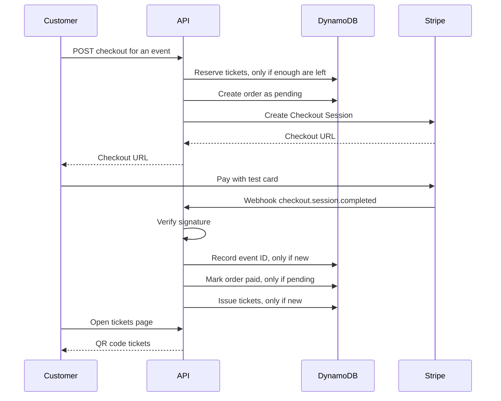

# Event Ticketing

A backend for selling event tickets with Stripe Checkout (test mode), DynamoDB, and QR code tickets. It never oversells, and it handles repeated Stripe webhooks safely.

**Demo video:** [Watch the 3-minute demo](https://www.youtube.com/watch?v=froUV6KnHh0)
- [Overselling is rejected](https://youtu.be/froUV6KnHh0?t=62)
- [Duplicate webhook ignored](https://youtu.be/froUV6KnHh0?t=92)

## What it does

1. A customer starts a checkout. The API reserves the tickets and creates a pending order.
2. Stripe Checkout collects payment (test mode, no real money).
3. Stripe sends a webhook. The API verifies it, marks the order paid, and issues one ticket per seat.
4. The customer sees QR code tickets. At the door, a check-in call marks a ticket as used, once.

## Architecture



## How overselling is prevented

Each event is a row in DynamoDB with a `tickets_left` counter. Buying tickets runs one conditional update: subtract the quantity only if `tickets_left >= quantity`. DynamoDB checks and subtracts in a single step, so two buyers going for the last ticket cannot both succeed. The loser gets a 409 response.

Tickets are held from the moment checkout starts. If the customer abandons checkout, Stripe's `checkout.session.expired` webhook returns the held tickets to inventory.

## How repeat webhooks are handled

Stripe can deliver the same event more than once. The webhook handler has three layers of protection:

1. **Signature check.** Every request is verified against the webhook signing secret. Forged requests get a 400.
2. **Event ID dedupe.** Each Stripe event ID is written to a `ProcessedWebhooks` table with a write-only-if-new condition. A repeat returns `duplicate` and does nothing. If processing fails, the record is removed so Stripe's retry can try again.
3. **Idempotent state changes.** Orders move from pending to paid (or expired) through conditional writes, and ticket IDs are derived from the order ID. Even a duplicate that gets past the first two layers cannot pay an order twice or issue extra tickets.

`replay_webhook.py` simulates a retry by sending the same signed event twice.

## Tickets and check-in

Each paid order gets one ticket per seat, shown as a QR code. Check-in is a conditional write that only succeeds while a ticket is still `valid`, so a ticket can be used once. A second scan gets a 409.

## Run it locally

```bash
git clone <this repo>
cd event-ticketing
python -m venv .venv
.venv\Scripts\activate        # Windows. On Mac or Linux: source .venv/bin/activate
pip install -r requirements.txt
cp .env.example .env          # then fill in your Stripe test keys
aws configure                 # a user with DynamoDB access, region us-east-2
python setup_tables.py
python seed_event.py
stripe listen --events checkout.session.completed,checkout.session.expired --forward-to localhost:8000/webhook
uvicorn main:app --reload
```

Put the signing secret that `stripe listen` prints into `STRIPE_WEBHOOK_SECRET` in `.env`, then open `http://localhost:8000/docs` to start a checkout. Pay with the Stripe test card `4242 4242 4242 4242`.

## Tests

```bash
pytest
```

12 tests run against a mocked DynamoDB (moto). They cover overselling, order status changes, ticket issuing, check-in, signature rejection, and repeated webhooks.

## Limitations

- Stripe test mode only.
- The check-in endpoint has no authentication. A real system would require staff login.
- Reserving tickets and saving the order are two separate writes, so a crash between them could lose the reserved tickets. A DynamoDB transaction would make this atomic.
- The mocked database does not simulate real contention.
- The expired-checkout flow is tested with simulated webhook events, not by waiting for a real session to expire.
- No email delivery of tickets.

## What I'd improve next

Transactions for order creation, authentication for check-in, ticket email through SES, a reconciliation job against Stripe's records, and deployment on AWS.

## How I built this

I built this with Claude, an AI assistant, as a pair-programming partner. Claude wrote the code in small pieces, and I ran each one, read the tests, and checked the behavior myself. I verified the system against Stripe test mode and a real DynamoDB table: I paid for a test checkout and confirmed the order and ticket records, tried to buy more tickets than were left and got rejected, and replayed a signed webhook to confirm duplicates are ignored. Along the way I debugged real setup problems, including an AWS policy that blocked DynamoDB in one region, a webhook signing secret that didn't match, and an expired Stripe CLI login.